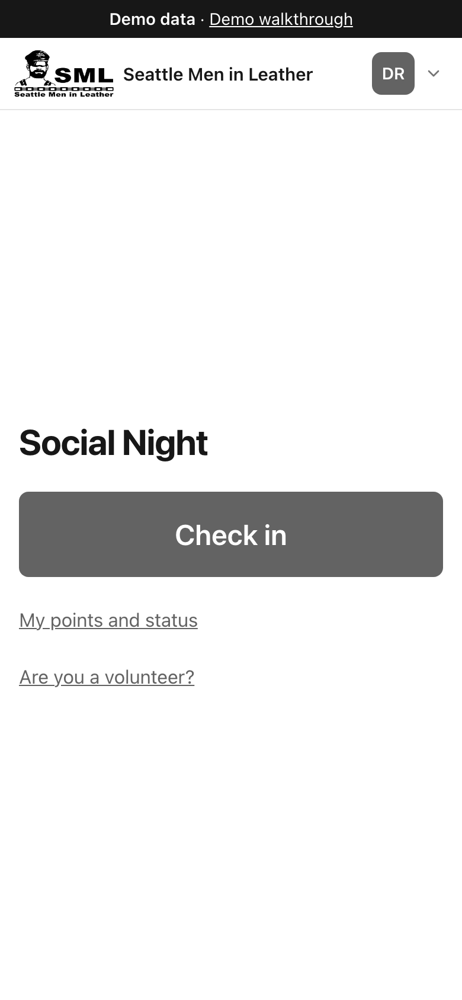
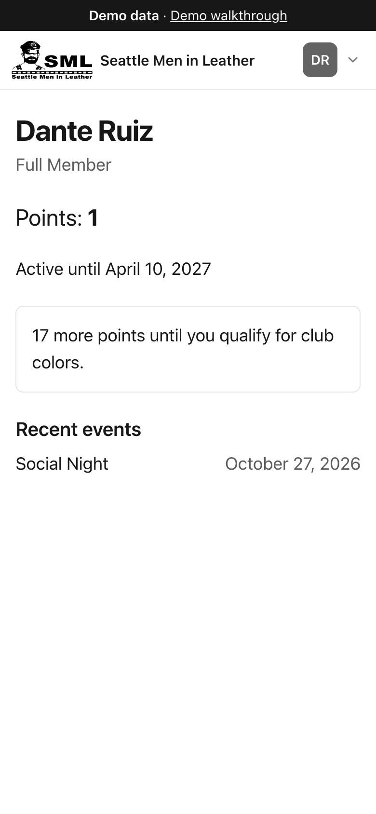
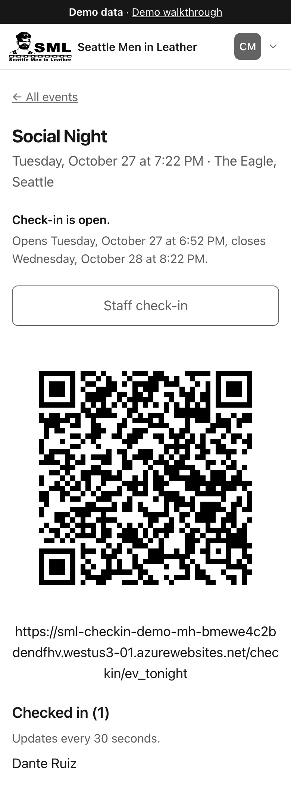

# SML Check-in

[](https://github.com/mik3ycodez/sml-checkin/actions/workflows/ci.yml)

Event check-in and points tool for Seattle Men in Leather (SML). TidyHQ is the
system of record; this app is a thin layer on top of it.

- Members scan an event QR code, sign in with TidyHQ, and check in with one tap.
- Check-in verifies active membership, records attendance in the event's TidyHQ
  contact group, and updates the member's points total.
- Members get a status page; the SML Board gets event QR codes, live attendee
  lists, and manual check-in.

**Status:** running on mock TidyHQ, live TidyHQ planned (1.0.0).

## Try the demo

<https://sml-checkin-demo-mh-bmewe4c2bdendfhv.westus3-01.azurewebsites.net>

The `/demo` page walks through every feature, with who to sign in as for each
scenario. The demo data resets whenever the server restarts.

## Screenshots

| Check in                                                                   | Member status                                                                | Admin attendee list                                                                    |
| -------------------------------------------------------------------------- | ---------------------------------------------------------------------------- | -------------------------------------------------------------------------------------- |
|  |  |  |
| One tap to check in at the door.                                           | Membership, points and recent events.                                        | Live attendee list and QR code for an event.                                           |

## How it works

- TidyHQ is the only data store. The app has no database of its own.
- A check-in makes at most three writes to TidyHQ, in this order: adding the
  member to the event's group, adding the points, and then (for staff
  check-ins only) a note saying a staff member did it.
- If something fails partway, a member can miss a point but is never awarded
  one twice.
- Admin and volunteer access fail closed: if the admin or volunteer group
  can't be read, nobody is let in.
- The server runs as exactly one instance, because the mock TidyHQ keeps its
  data in memory.

The full list of rules is in the
[Invariants in CLAUDE.md](CLAUDE.md#invariants).

## Stack

Next.js 16, React 19, TypeScript, Tailwind CSS 4, Vitest, Playwright, and Azure
App Service deployed from GitHub Actions with OIDC.

## Run it locally

Requires Node 24 (see `.nvmrc`).

```bash
npm install                  # install dependencies
cp .env.example .env.local   # required: local settings
openssl rand -base64 32      # generate a value for SESSION_SECRET
npm run dev                  # dev server at http://localhost:3000
```

Put the generated value in `.env.local` as `SESSION_SECRET`. Sign-in needs it
even in mock mode. Once the server is running, open
<http://localhost:3000/demo> to see who to sign in as.

## Mock vs live TidyHQ

The client is chosen by `TIDYHQ_MODE` (`mock`, the default, or `live`).

- **Mock** runs against an in-memory TidyHQ with seed members and events
  (`src/lib/tidyhq/mock/seed.ts`). Data resets whenever the server restarts.
  A production server refuses mock mode unless `DEMO_MODE=on`, which puts a
  "Demo data" banner on every page.
- **Live** is built but not yet pointed at SML's TidyHQ. It refuses to start
  unless every credential in `.env.example` is filled in. See the
  [go-live checklist](docs/plans/milestone-5.md#go-live-checklist-live-tidyhq).

## Tests and checks

```bash
npm test               # run the test suite once
npm run test:watch     # re-run tests on file changes
npm run typecheck      # TypeScript type check
npm run lint           # ESLint
npm run format:check   # Prettier check
```

### End-to-end tests

```bash
npx playwright install   # one-time: downloads the WebKit and Chromium browsers
npm run test:e2e         # builds the app and runs the specs in e2e/
npx playwright show-report   # open the HTML report (after a CI-mode run)
```

`playwright.config.ts` sets `E2E=1`, which turns on `POST /mock-tidyhq/reset`
(mock mode only). Don't set it anywhere else.

## Project docs

- [CLAUDE.md](CLAUDE.md) and [`.claude/rules/`](.claude/rules): scope, design
  decisions and the detailed rules.
- [`docs/plans/`](docs/plans): one plan per milestone, with status.
- [`docs/azure-demo.md`](docs/azure-demo.md): the Azure demo host and deploys.
- [AGENTS.md](AGENTS.md): instructions for coding agents.

## Releases

Versioning is described in [CLAUDE.md](CLAUDE.md#versioning); releases are on
GitHub Releases.

## About this project

SML Check-in is built with [Claude Code](https://claude.com/claude-code). I'm on the SML Board and act as the product owner: I set the requirements, made the design and security decisions, reviewed every plan and pull request, tested on real phones, and run the releases and the Azure demo. Claude Code wrote the code, tests and docs under the project rules in CLAUDE.md, which also record the reasoning behind each decision.

## Contributing

Bug reports and ideas are welcome as issues. Pull requests aren't being accepted for now, because the app is built and maintained for SML. To report a security problem, see [SECURITY.md](SECURITY.md).

## License

Apache 2.0, copyright Seattle Men in Leather. The SML name and logos are not
covered by the license. See [NOTICE](NOTICE).
